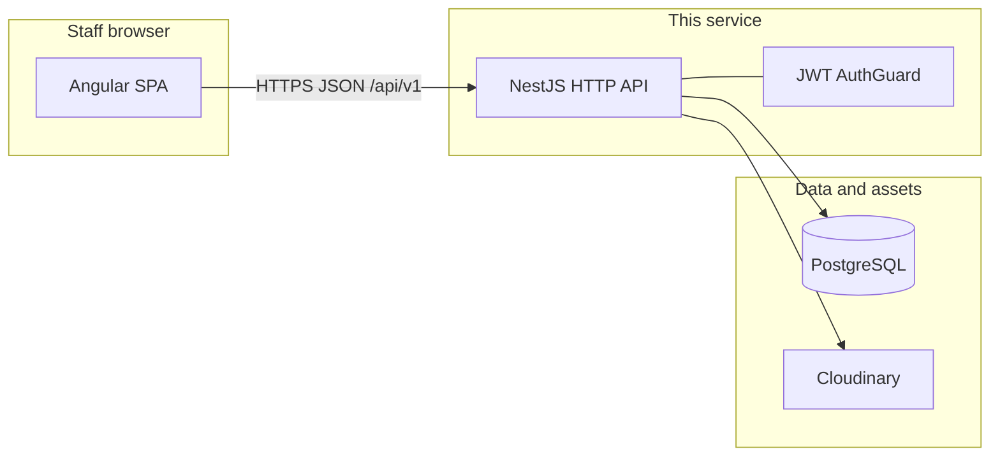

# Architecture — nest-server

**Sibling UI repo:** `cvc-angular` — see its `docs/ARCHITECTURE.md` for the SPA container.

## System context

Staff use the **Angular app** to manage products, customers, orders, sources, and reports. This service is the **only** persistence and business-logic tier those screens call.

## Containers

| Container | Technology | Responsibility |
|-----------|------------|----------------|
| HTTP API | NestJS | REST endpoints, validation, orchestration |
| Database | PostgreSQL | Relational data via TypeORM |
| File uploads | Cloudinary | Product images and allowed file types (see `FileModule`) |

## Cross-cutting behavior

1. **Global prefix:** `/api/v1` on all controllers (`main.ts`).
2. **Authentication:** `AuthGuard` is registered globally; endpoints that must skip JWT use `@Public()`.
3. **Success envelope:** `ResponseInterceptor` wraps handler results in `GenericResponseDto` (`payload`, `metadata`).
4. **Errors:** `CustomExceptionFilter` returns JSON with `GenericResponseDto` and `error` populated.
5. **Documentation:** Swagger UI at `/api` (not under `/api/v1`).
6. **CORS:** Enabled broadly (`enableCors()`); see `SECURITY_NOTES.md` for implications.

## Major flows (logical)

**Login:** `POST /api/v1/auth/login` → validates user → JWT; client stores token and sends `Authorization: Bearer <token>` on subsequent calls.

**Create order:** Validates `CreateOrderDto` → resolves customer and order sources → persists `Order` and `OrderItem` rows → returns hydrated order (with relations as implemented in `OrderService`).

**Reports:** `POST /api/v1/reports` accepts report type descriptors; `ReportServiceRegistry` delegates to order- or product-specific report services.

**File upload:** `POST /api/v1/files/upload` (public) streams to Cloudinary with format allowlist.

## Related decisions

See [`docs/adr/`](adr/) for recorded architecture decisions (JWT model, response envelope, persistence strategy).
