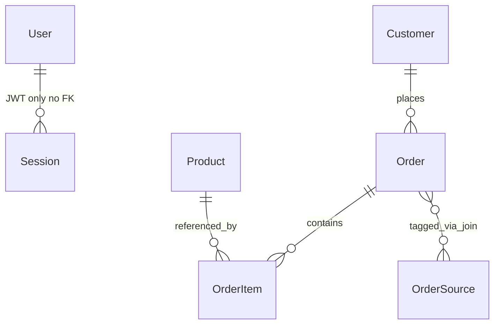

# Domain model — nest-server

Relational model for **Customize With Class**. Authoritative definitions live in `src/entities/*.entity.ts` and migrations under `src/database/migrations/`.

**Frontend mirror:** `cvc-angular/docs/DOMAIN_MODEL.md` (narrative summary + pointer here).

---

## Entity relationship (conceptual)

- **User:** Staff accounts (login); not linked as FK from `Order` in the current schema.
- **Customer:** Buyer profile; **one customer → many orders**.
- **Order:** Order header + status + dates + totals; **many order items**; **many-to-many** with **OrderSource** via join table `order_to_sources` (entity `OrderToSource` exists for updates).

---

## Entities (tables)

| Entity | Table name (when explicit) | Purpose |
|--------|----------------------------|---------|
| `User` | `users` | Staff: `fullName`, `email`, `password` (hashed), optional profile fields. |
| `Customer` | `customers` | `fullName`, `age`, `country`, `city`, **`province`**, `address`, `contactNumber`. |
| `Product` | (default) | Unique `name`, `description`, `cost`, `weight`, optional `thumbnailImage`. |
| `Order` | `orders` | `description`, `amount`, `paymentMethod`, `quantity`, `totalWeight`, **`status`** (enum), **`orderDate`**, FK to customer, M2M sources. |
| `OrderItem` | `order-items` | FK to order + product; line `price`, `quantity`, optional **`color`**, **`customizeName`**. |
| `OrderSource` | `order-sources` | Channel catalog: `name`, **`type`** (enum: instagram / facebook / web), `description`. |
| `OrderToSource` | `order_to_sources` | Join rows between orders and sources (used when replacing sources on update). |

---

## Enums

### Order status (`OrderStatus`)

File: `src/modules/order/enums/order-setatus.enum.ts` (filename typo preserved).

| Value | Meaning (operational) |
|-------|------------------------|
| `pending` | New / not yet with vendor |
| `vendor` | With vendor / production |
| `dispatched` | Shipped |
| `delivered` | Completed delivery |
| `returned` | Returned |

### Order source type (`OrderSourceType`)

File: `src/modules/order/enums/order-source-type.enum.ts`.

| Value | Meaning |
|-------|---------|
| `instagram` | Instagram channel |
| `facebook` | Facebook channel |
| `web` | Web channel |

---

## Invariants (from DTOs / services)

- **Create order** (`CreateOrderDto`): requires `description`, `amount`, `paymentMethod`, `customerId`, non-empty **`orderItems`**, **`orderDate`**, non-empty **`orderSourceIds`**. Optional: `totalWeight`, `totalProductQuantity`.
- **Products:** `name` is unique in the database.
- **Reporting:** Customer **`province`** and order **sources** feed geographic and channel reports.

---

## Migrations

Schema changes must go through **TypeORM migrations** (`npm run migration:*`). `synchronize` is **disabled** in production configuration.
